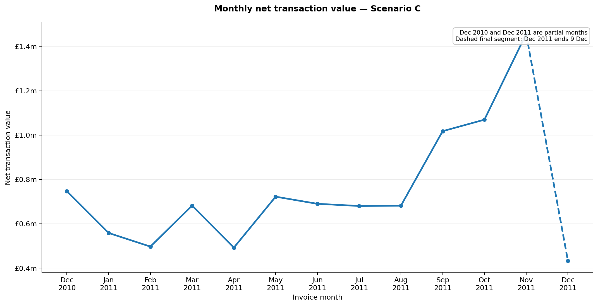
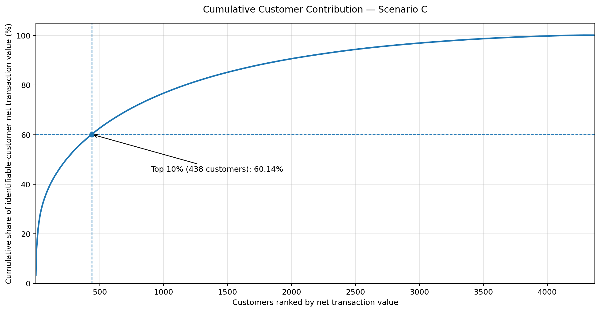

# Online Retail SQL Portfolio Project

## Project overview
This project analyses the UCI Online Retail transactional dataset using MySQL. It explores sales performance, product performance, customer behaviour, geographical performance and cancellation-associated transaction activity.

I investigated data-quality issues, compared alternative transaction populations and selected Scenario C as the primary reporting basis. The original source table is retained unchanged; analysis is performed using a prepared view and a physical analysis table.

## Dataset and environment
- **Dataset:** UCI Online Retail
- **Source:** [UCI Machine Learning Repository](https://archive.ics.uci.edu/dataset/352/online-retail)
- **Citation:** Chen, D. (2015). *Online Retail* [Dataset]. UCI Machine Learning Repository. https://doi.org/10.24432/C5BW33
- **Licence:** Creative Commons Attribution 4.0 International (CC BY 4.0). Credit the original source when sharing or adapting the dataset.
- **Database:** `online_retail_analysis`
- **Source table:** `retail_transactions`
- **Analysis view:** `vw_retail_transactions_analysis`
- **Physical analysis table:** `retail_transactions_analysis`
- **Platform:** MySQL Server 8.0.46 / MySQL Workbench 8.0.46

The imported source dataset contained 541,909 records, covering 1 December 2010 to 9 December 2011 and representing 38 countries. UCI confirms the dataset contains 541,909 instances and lists the CC BY 4.0 licence and DOI citation.

## Repository structure
```text
online-retail-sql-analysis/
├── 01_data_setup/
│   ├── 01_create_database_and_table.sql
│   └── 02_data_import_and_validation.sql
├── 02_data_preparation/
│   ├── 01_data_quality_checks.sql
│   └── 02_analysis_view_and_table.sql
├── 03_business_analysis/
│   ├── BQ1_sales_performance.sql
│   ├── BQ2_product_performance.sql
│   ├── BQ3_customer_and_geographical_performance.sql
│   └── BQ4_cancellation_associated_analysis.sql
├── 04_validation/
│   └── final_reconciliation_checks.sql
├── 05_visualisations/
│   ├── chart_data_queries.sql
│   ├── monthly_net_transaction_value.png
│   ├── monthly_net_transaction_value.csv
│   ├── customer_contribution_concentration.png
│   └── customer_contribution_concentration.csv
└── README.md
```

## How to run the project
1. Run `01_data_setup/01_create_database_and_table.sql` to create the database and original source table.
2. Download the dataset from UCI, prepare the CSV used for import, and import it into `retail_transactions`.
   - The original import used MySQL `LOAD DATA LOCAL INFILE`.
   - The exact original import statement, local file path and settings were not retained. The import SQL now contains a clearly labelled template; adapt the path, delimiter, quoting, line endings, header handling and date parsing to the CSV you prepare.
   - The original import returned four warnings, but their details were not retained. No warning details are inferred or reproduced.
3. Run `01_data_setup/02_data_import_and_validation.sql` to check row count, sample records, date range and country count.
4. Run `02_data_preparation/01_data_quality_checks.sql`.
5. Run `02_data_preparation/02_analysis_view_and_table.sql` to create/refresh the analysis view and rebuild the derived analysis table. It drops only `retail_transactions_analysis`; it does not drop or modify `retail_transactions`.
6. Run the four scripts in `03_business_analysis/`.
7. Run `04_validation/final_reconciliation_checks.sql`.
8. Run `05_visualisations/chart_data_queries.sql` and export each result set as CSV to create the proposed charts.

The scripts were developed for MySQL 8.0.46. The business-question scripts and nine reconciliation checks were executed in the project environment. The import step remains environment-specific.

## Data preparation and analytical decisions
- **Exact duplicates:** exact matches across all eight source columns were classified as `Unique`, `Primary Duplicate` and `Secondary Duplicate`. Unique and primary duplicate rows are retained for primary reporting; secondary duplicates are excluded.
- **Negative quantities:** retained; not automatically assumed to represent cancellations or returns.
- **C-prefixed invoice references:** retained in Scenario C and analysed separately as a cancellation-associated indicator, not definitive proof of cancellation.
- **Zero unit prices:** retained and investigated.
- **Negative unit prices:** retained and flagged; the identified records relate to `Adjust bad debt`, not ordinary product sales.
- **Missing descriptions:** retained as NULL; no imputation. `StockCode` is used as the product identifier.
- **Missing CustomerID:** retained in the analysis dataset. Customer analysis excludes unidentifiable customers; country analysis includes them.
- **Product exclusions:** `AMAZONFEE`, `B`, `DOT`, `M`, `POST` and `S` are excluded from final product rankings. `DCGSSBOY`, `DCGSSGIRL` and `PADS` are retained.

### Reporting scenarios
- **Scenario A:** all records, including secondary duplicates and C-prefixed invoice references.
- **Scenario B:** all records, excluding C-prefixed invoice references.
- **Scenario C (primary reporting basis):** excludes secondary exact duplicates and retains C-prefixed records.
- **Scenario D (sensitivity comparison):** excludes secondary exact duplicates and C-prefixed records.

I selected Scenario C because it removes secondary exact duplicates while retaining C-prefixed records. The BQ2 investigation found that StockCode `23843` had a positive transaction paired with a C-prefixed negative transaction of the same quantity and value. Excluding C-prefixed records could therefore remove the negative side while retaining the positive side, distorting product performance. Scenario D is a sensitivity comparison; final product rankings use Scenario C.

## Business questions and key findings

### BQ1 — Sales performance over time
- Scenario C net transaction value: **£9,726,006.95**.
- November 2011 was the strongest month: **£1,456,145.80**.
- September, October and November 2011 each exceeded £1 million.
- April 2011 was the weakest complete calendar month.
- Scenario D net transaction value was **£10,619,986.68**; excluding C-prefixed records increases the net total in this dataset.
- December 2010 and December 2011 are partial periods.

**Business interpretation:** Net transaction value increased from September to November 2011. This warrants further investigation of seasonal demand and trading activity, but the dataset alone does not establish the cause.

### BQ2 — Product performance
- Product performance is grouped by `StockCode`, not description text.
- StockCode `22423` ranked first by net transaction value (**£164,459.49**).
- StockCode `22197` ranked first by net quantity (**56,427**).
- Five StockCodes appeared in both top-ten rankings: `85099B`, `85123A`, `23084`, `84879` and `22197`.
- The top-ten quantity ranking retained the same product composition in the zero-price sensitivity check, although some quantities and ranks changed.

**Business interpretation:** The highest-volume product is not necessarily the highest-value product. Reviewing both rankings can support more balanced purchasing, stock allocation and product-performance decisions.

### BQ3 — Customer behaviour and geographical performance
- The retained analysis population contains **4,372 identifiable customers**.
- Identifiable-customer net transaction value: **£8,278,519.42**.
- Missing CustomerID records account for **£1,447,487.53** and remain in overall and country-level populations.
- The top 10% of identifiable customers (438 customers) account for **60.14%** of identifiable-customer net transaction value.
- The UK accounts for **£8,167,128.18**, or **83.97%**, of overall Scenario C net transaction value.
- Country is the country recorded on the transaction, not necessarily verified customer residence.

**Business interpretation:** A relatively small share of identifiable customers accounts for a substantial proportion of customer-attributed net transaction value. This indicates concentration and may justify monitoring exposure to high-value accounts while exploring opportunities to broaden the customer base. It does not establish customer loyalty or future churn.

**What I would tell the business:** The results point to two related concentration risks: 83.97% of net transaction value is associated with the UK, while the top 10% of identifiable customers contribute 60.14% of identifiable-customer value. I would monitor sales and customer contribution by country and over time, track changes in the contribution of the highest-value customers, and investigate whether growth opportunities exist in other markets and across a broader customer base. These findings identify areas to monitor; they do not, on their own, prove that revenue or customer relationships are at risk.

### BQ4 — Cancellation-associated transaction analysis
- There are **9,251 retained C-prefixed records** across **3,836 distinct invoices**.
- C-prefixed records represent approximately **1.72%** of retained analysis records.
- December 2011 has the largest negative quantity (**-83,569**) and negative transaction value (**-£205,089.27**).
- StockCodes `23843` and `23166` are prominent in the product-level analysis.
- `M` is a manual transaction code, not a conventional product.
- The intersection of the top-ten negative-quantity and negative-value rankings contains five codes: `21108`, `23166`, `23843`, `85123A` and `M`.

**Business interpretation:** C-prefixed activity is a relatively small share of records but can materially affect net transaction value and product rankings. The prefix remains a proxy, not a definitive cancellation classification.

## Visualisations

The following charts were generated from the Scenario C monthly output and the customer cumulative-contribution output. The chart datasets are included alongside each image so the visualisations can be inspected and reproduced.

### Monthly net transaction value



The chart shows all 13 monthly periods in the dataset. December 2010 and December 2011 are partial periods; the final December ends on 9 December 2011.

### Customer contribution concentration



The curve ranks 4,372 identifiable customers by net transaction value. The top 438 customers (approximately 10% of identifiable customers) account for 60.14% of identifiable-customer net transaction value. Customer records without a populated CustomerID are excluded from this customer-level chart.

The underlying chart data is provided in `monthly_net_transaction_value.csv` and `customer_contribution_concentration.csv`. `chart_data_queries.sql` contains the SQL used to reproduce the same columns and measures from the analysis table.

## Important interpretation and limitations
- `line_value` is `Quantity * UnitPrice`. Totals are **net transaction value**, not recognised revenue.
- C-prefixed invoice numbers are a proxy for cancellation-associated activity; the prefix alone does not prove the status of every record.
- Negative quantities can occur on non-C-prefixed invoices and may reflect other operational or accounting events.
- The dataset ends on 9 December 2011; December 2011 is incomplete.
- Missing CustomerID affects customer attribution but does not justify removing transactions from overall or country analysis.
- StockCodes can have multiple descriptions, so description is not treated as a stable product key.
- The analysis does not establish recognised revenue, customer residence or the underlying reason for every adjustment.

## Validation
**Execution status: completed in the project environment.** All nine reconciliation checks in `04_validation/final_reconciliation_checks.sql` were executed in MySQL Workbench and passed. The results from the four business-question analyses were reviewed for consistency with the reported findings. This covered 10 result sets for BQ1, 15 for BQ2, 8 for BQ3 and 5 for BQ4.

The validation script checks source/view/table row counts, duplicate classification, retained population, customer-ID population, financial reconciliation, monthly totals, product population, customer/country totals, C-prefixed counts and view/table agreement. Users reproducing the project should rerun these checks against their own imported dataset.

## Project integrity and reproducibility
The original source table is retained separately from the derived analysis table. Exploratory queries are labelled where relevant, and superseded definitions are not presented as authoritative. The original import statement, local path and four warning details were not retained; the import script therefore provides a clearly marked template rather than claiming to reproduce the original command.
